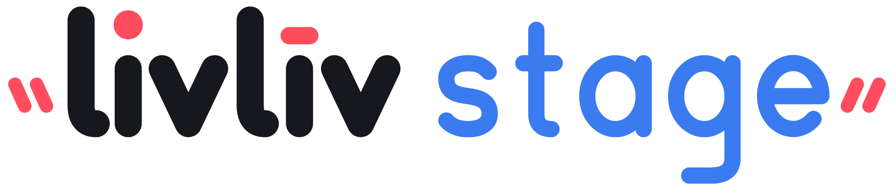
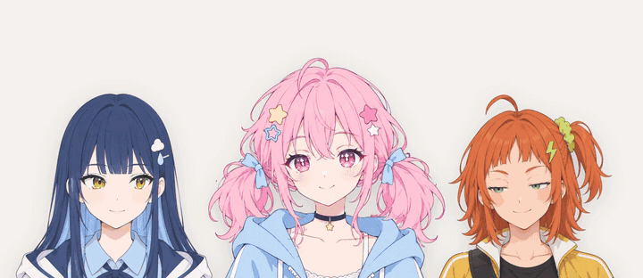
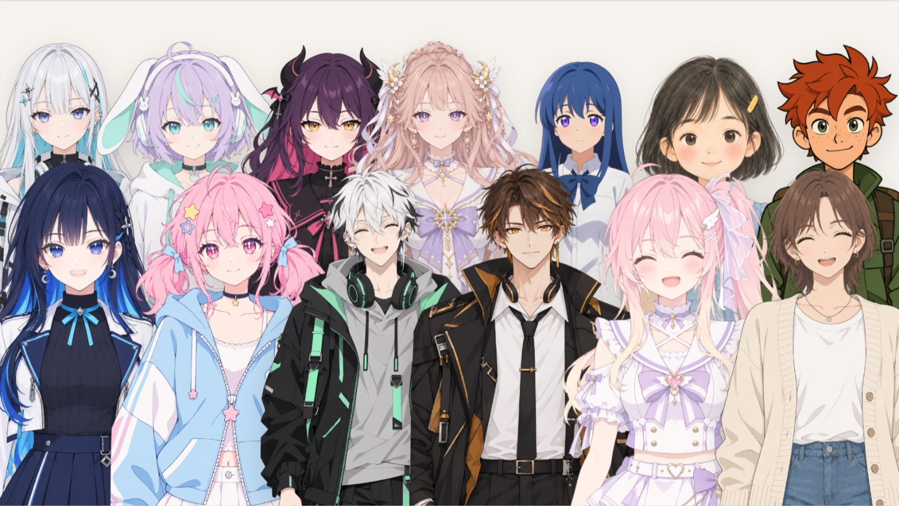
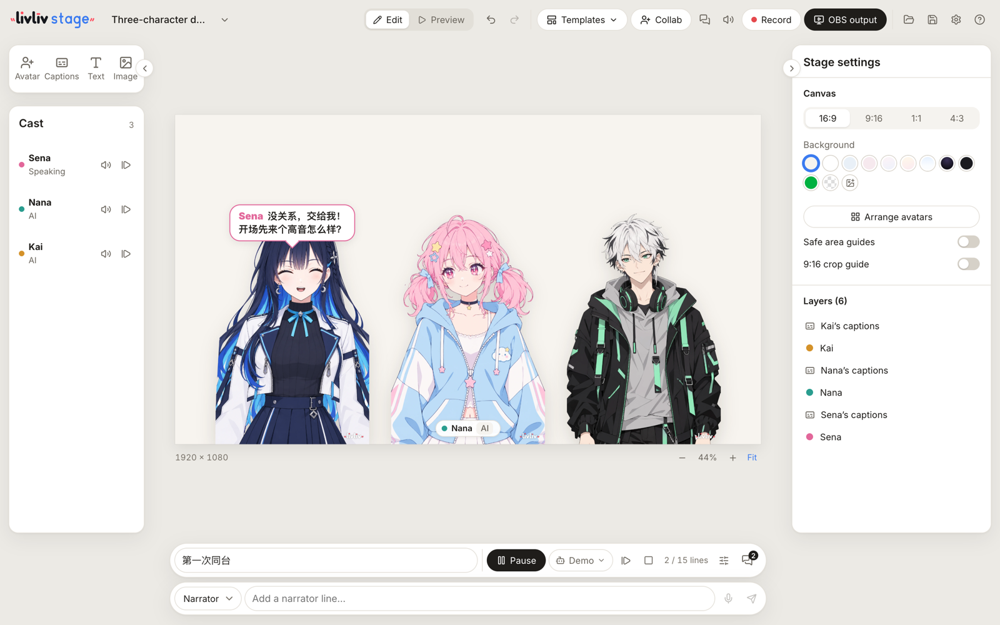

<p align="center">
  <picture>
    <source media="(prefers-color-scheme: dark)" srcset="media/livliv-stage-wordmark-white.svg">
    
  </picture>
</p>

<h3 align="center">あなたの AI ネイティブ VTuber スタジオ<br><sub>たくさんのキャラクター、ひとつのステージ。</sub></h3>

<p align="center">
  2D キャラクターのためのステージ。ブラウザでもデスクトップアプリでも動きます。たくさんのキャラクターをひとつのキャンバスに並べ、
  Web カメラで自分が演じ、AI VTuber どうしの掛け合いや配信コメントへの返事を任せて、動画に書き出したり OBS で配信したりできます。<br>
  <a href="https://github.com/livliv-dev/player">LivLiv Player</a> がベースで、厳選キャラクター 27 体を同梱。すぐに使えます。
</p>

<p align="center"><a href="README.md">English</a> · <a href="README.zh-CN.md">中文</a> · <b>日本語</b></p>

<p align="center"></p>

- **たくさんのキャラクターを、ひとつのステージに**：LivLiv、VRM、PNGTuber のキャラクターを並べられます。キャラクターごとに動かし方、声、字幕を設定できます。
- **AI VTuber**：キャラクターどうしが会話し、Twitch のコメントにも答えます。モデルは自分の API キーで（OpenAI、DeepSeek、
  Qwen、Kimi、Zhipu、OpenRouter、Ollama、OpenAI 互換の任意の API）、声は自分の音声 API か LivLiv のものを使います。
- **自分もステージに**：Web カメラのフェイストラッキング、マイクのリップシンク、マウス。デスクトップ版ではスマホのトラッキングアプリ
  （iFacialMocap）、VMC/OSC、グローバルホットキーにも対応。ゲームパッドも使えます。
- **そのまま投稿できる**：ステージ全体を MP4 に録画、または OBS 用の透過出力ウィンドウを開けます。シーンとショット、キャラクターに
  付いて動く小物、コメントのコマンドで変わる表情も。
- **友だちと同じステージに**：最大 4 人がそれぞれ 1 体ずつキャラクターを持ち寄り、自分で立てたシグナリングサーバー経由の WebRTC でつながります。

<p align="center"></p>

## 試してみる

Node.js 22.18 以降が必要です。

```sh
git clone https://github.com/livliv-dev/stage
cd stage
npm --prefix stage ci
npm --prefix stage run dev          # http://127.0.0.1:5222
```

デスクトップ版（Electron）は同じコードで動き、こちらがおすすめです。

```sh
npm --prefix desktop ci
npm --prefix desktop run stage:dev   # stage:mac と stage:win でインストーラーを作成
```

インストーラーはまだ公開していません。ビルドしたアプリは署名されていません。初回起動時に「デモを見る」を押すと、Nana、Sena、Kai の
掛け合いが流れます（収録済みの声で、キーは不要）。テンプレートを選んでモデルをつなげば、自由に会話させることもできます。

<p align="center"></p>

## キャラクター

[`stage/public/characters/`](stage/public/characters/) に厳選キャラクター 27 体が入っています。Tsubaki、Neve、Juno、Viola は全身のキャラクターで、表示範囲はキャラクターの**見た目**で選べます。コードのライセンスの対象外です。
個人の非商用の動画や配信では無料で使えます。クレジット（「キャラクター：LivLiv（livliv.ai）」）を入れてください。
条件は [LICENSE.md](stage/public/characters/LICENSE.md) にあります。

自分のキャラクターは「インポート」から：

- **LivLiv モデル**：[livliv.ai](https://livliv.ai) で 1 枚の絵からキャラクターを作り、モデルパッケージ（`.livliv`）をダウンロード。
  全身のキャラクターも使えます。足は地面に着いたまま、表示範囲（頭と胸まで・膝まで・全身）を選べます。livliv.ai ではまだ全身キャラクターのパッケージを提供していません。
- **VRM**：VRoid Studio など、VRM 0.x / 1.0 を書き出せるツールのモデル。
- **PNGTuber**：2 枚の画像（口を閉じた絵と開いた絵）。目を閉じた絵があればさらに 2 枚。

## キーとデータ

- モデルや音声の API キーは、このブラウザかアプリの中にだけ保存されます。リクエストは PC からサービスへ直接送られ
  （デスクトップ版はアプリ自身が中継）、LivLiv を経由しません。プロジェクトファイルにキーは含まれません。料金はサービスから請求されます。
- フェイストラッキングは Google の MediaPipe を PC 上で動かします。カメラ映像は PC の外に出ません。
- livliv.ai へのログインは任意です。ログインすると、そこで作ったキャラクターと、その子の声が使えます（livliv.ai のポイントを消費）。
- Stage で作った動画、録画、プロジェクトはあなたのものです。

## 現状

開発プレビュー版（0.2.2-preview.1）です。macOS の Chromium とデスクトップ版でテストしています。未テスト：Windows、スマートフォン、
実機のゲームパッド、OBS の音声と映像の同期、公開リレー経由の共同配信。Live2D（Cubism）モデルは再生できません。

## Project LivLiv

誰もが、思い描いたキャラクターをかたちにできるように。それが私たちの願いです。

AI を使ったキャラクター制作のツール群、プレイヤーとその再生プロトコル、そしてキャラクターをお披露目できる舞台をオープンソース化しています。

ぜひ [Discord](https://discord.gg/ac5qF36T2H) に遊びに来てください。[X（Twitter）](https://x.com/livliv_ai) でも LivLiv をフォローしてもらえたらうれしいです。

## 開発

```sh
npm --prefix stage run check && npm --prefix stage test
npm --prefix desktop test
npm --prefix collab test
```

設計メモ（中国語）は [docs/](docs/)、ローカル制御 API は [docs/stage-api.md](docs/stage-api.md)、共同配信サーバーは
[collab/README.md](collab/README.md) にあります。コントリビュートは [CONTRIBUTING.md](CONTRIBUTING.md) を、セキュリティの報告は
[SECURITY.md](SECURITY.md) をご覧ください。

## ライセンス

コードは [GNU AGPL バージョン 3](LICENSE) で公開しています。厳選キャラクターには[独自のライセンス](stage/public/characters/LICENSE.md)があります。
LivLiv の名称とロゴはコードのライセンスに含まれません：[TRADEMARKS.md](TRADEMARKS.md)。
