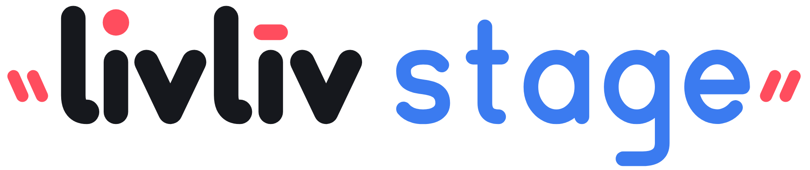
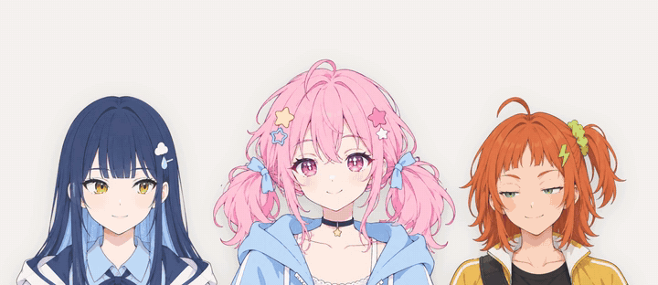
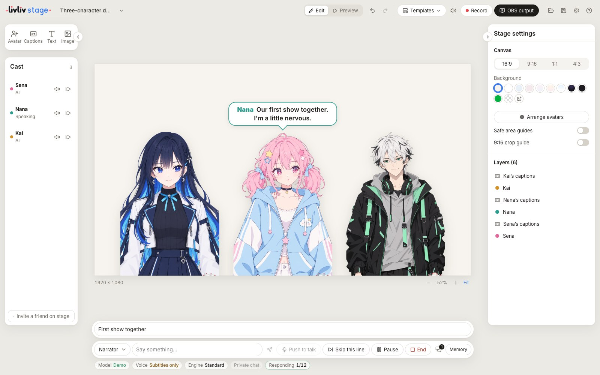

<p align="center">
  <picture>
    <source media="(prefers-color-scheme: dark)" srcset="media/livliv-stage-wordmark-white.svg">
    
  </picture>
</p>

<h3 align="center">あなたの AI VTuber スタジオ</h3>

<p align="center">
  キャラクターに性格を設定すれば、数分であなたとおしゃべりしたり、そのまま配信したり。自分で演じることもできます。
</p>

<p align="center"><a href="README.md">English</a> · <a href="README.zh-CN.md">中文</a> · <b>日本語</b></p>

<p align="center"></p>

- ひとつのステージに最大 30 体（ブラウザでは 15 体）：LivLiv の半身・全身、VRM、PNGTuber
- 長期記憶とリアルタイム音声会話
- キャラクター同士の掛け合いと、Twitch コメントへの返事
- 話しながら感情に合わせて変わる表情
- デスクトップ版の AI チャット：キャラクターごとに記憶を持ちます。[Project AIRI](https://github.com/moeru-ai/airi) を利用
- デスクトップ版のゲーム接続：Minecraft（[Airicraft](https://github.com/proj-airi/airicraft)）、Factorio（[Autorio](https://github.com/moeru-ai/airi-factorio)）、または任意のゲームウィンドウ
- Neuro SDK に標準対応（デスクトップ版）
- 基本機能：Web カメラのフェイストラッキング（スマホアプリと VMC/OSC はデスクトップ版）、OBS 出力、動画の録画
- 厳選キャラクター 27 体、すぐに使えます。[LivLiv Player](https://github.com/livliv-dev/player) がベース

AI は自分のモデルの API キー（OpenAI、Qwen、DeepSeek など）、または LivLiv.ai アカウントで利用できます。
リアルタイム音声には OpenAI か Alibaba Cloud Bailian のキーが必要です。

## 試してみる

- **デスクトップ版**：macOS と Windows 版を [Releases](https://github.com/livliv-dev/stage/releases/latest) から。
  GitHub からのダウンロードが遅い場合は[予備のダウンロード](https://downloads.livliv.ai/stage/index.html)をご利用ください。
  macOS はターミナルで 1 行入力してもインストールでき、初回の確認は出ません：`curl -fsSL https://livliv.ai/stage/install.sh | bash`
- **オンライン（Web版・機能制限あり）**：[livliv.ai/stage](https://livliv.ai/stage)
- **ソースから**：[開発](#開発)を参照

<p align="center"></p>

## キャラクター

厳選キャラクターには[専用のライセンス](stage/public/characters/LICENSE.md)があります。自分のキャラクターは「インポート」から：
[livliv.ai](https://livliv.ai) のモデルパッケージ（`.livliv`）、VRM、PNGTuber。

## Project LivLiv

誰もが、思い描いたキャラクターをかたちにできるように。それが私たちの願いです。

AI を使ったキャラクター制作のツール群、[プレイヤーとその再生プロトコル](https://github.com/livliv-dev/player)、そして[キャラクターをお披露目できる舞台](https://github.com/livliv-dev/stage)をオープンソース化しています。

ぜひ [Discord](https://discord.gg/ac5qF36T2H) に遊びに来てください。[X（Twitter）](https://x.com/livliv_ai) でも LivLiv をフォローしてもらえたらうれしいです。

## 開発

Node.js 22.18 以降が必要です。

```sh
git clone https://github.com/livliv-dev/stage
cd stage
npm --prefix stage ci && npm --prefix stage run dev            # Web 版、http://127.0.0.1:5222
npm --prefix desktop ci && npm --prefix desktop run stage:dev  # デスクトップ版（stage:mac と stage:win でインストーラーを作成）
```

テスト：`npm --prefix stage run check && npm --prefix stage test`、`npm --prefix desktop test`、`npm --prefix collab test`。
AI チャットと記憶は [docs/ai-conversations.md](docs/ai-conversations.md)、リアルタイム音声は [docs/realtime-voice.md](docs/realtime-voice.md)、
Neuro SDK ブリッジは [neuro/README.md](neuro/README.md)、ローカル制御 API は [docs/stage-api.md](docs/stage-api.md)、共同配信は [collab/README.md](collab/README.md) にあります。
モデルの API キーはブラウザかアプリの中にだけ保存され、サービスへ直接送られます。コントリビュートは [CONTRIBUTING.md](CONTRIBUTING.md)、
セキュリティの報告は [SECURITY.md](SECURITY.md) へ。

## ライセンス

コードは [Apache License 2.0](LICENSE) で公開しています。厳選キャラクターには[独自のライセンス](stage/public/characters/LICENSE.md)があります。
LivLiv の名前とロゴは、公式版を名乗らない限り、あなたのバージョンでもそのまま使えます：[TRADEMARKS.md](TRADEMARKS.md)。
