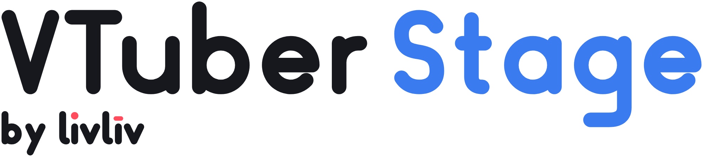
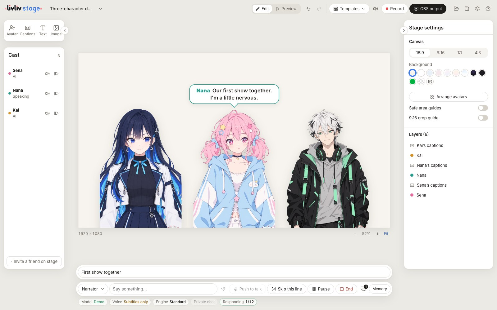

<p align="center">
  <picture>
    <source media="(prefers-color-scheme: dark)" srcset="media/vtuber-stage-wordmark-white.svg">
    
  </picture>
</p>

<h3 align="center">Your AI VTuber Studio</h3>

<p align="center">
  Give a character a personality, and in minutes it's chatting with you or streaming live. Or play it yourself.
</p>

<p align="center"><b>English</b> · <a href="README.zh-CN.md">中文</a> · <a href="README.ja.md">日本語</a></p>

<p align="center"></p>

## New in 1.0 Preview

Stage is reorganised around what you came to do. [Download the 1.0 Preview](https://github.com/livliv-dev/vtuber-stage/releases/tag/v1.0.0-preview).

- **Start with a goal**: **I perform**, **AI goes live**, **Chat with a character** or **Make a video**. Each shows only what it needs, and one button starts it
- **Free voices on your computer** with [Voicebox](https://voicebox.sh) (desktop app)
- **Import character cards** from SillyTavern and AIRI
- **New name**: LivLiv Stage is now VTuber Stage, by LivLiv (on livliv.ai it keeps the old name). Your settings, keys and projects stay as they are

## Also in Stage

- Up to 30 characters on one stage: LivLiv, VRM and PNGTuber, with 24 featured characters
- Characters talk to each other and to your Twitch chat, with memory ([Project AIRI](https://github.com/moeru-ai/airi)) and realtime calls
- Face tracking, OBS output, recording, games and the Neuro SDK

The AI runs on your own model key (OpenAI, Qwen, DeepSeek and more) or your LivLiv.ai account.

## Try it

- **Desktop app** (macOS, Windows): the [1.0 Preview](https://github.com/livliv-dev/vtuber-stage/releases/tag/v1.0.0-preview), or the [stable version](https://github.com/livliv-dev/vtuber-stage/releases/latest) ([backup download](https://downloads.livliv.ai/stage/index.html)).
  On macOS, one line installs the stable version with no first-open prompt: `curl -fsSL https://livliv.ai/stage/install.sh | bash`
- **Online (Web, limited features)**: [livliv.ai/stage](https://livliv.ai/stage)
- **From source**: see [Develop](#develop)

<p align="center"></p>

## Characters

The featured characters have [their own licence](stage/public/characters/LICENSE.md). **Import** brings your own: a
`.livliv` package from [livliv.ai](https://livliv.ai), a VRM, or a PNGTuber.

## Project LivLiv

We want the art of creating characters to belong to everyone.

We're open-sourcing our AI tools for character creation, [the player and its playback protocol](https://github.com/livliv-dev/player),
and [a stage where your characters can meet an audience](https://github.com/livliv-dev/vtuber-stage).

Come say hello on [Discord](https://discord.gg/ac5qF36T2H) and follow us on [X (Twitter)](https://x.com/livliv_ai).

## Develop

Node.js 22.18 or later. Stage uses a temporary LivLiv Player build until the next Player release ([vendor/player-temporary](vendor/player-temporary/README.md)).

```sh
git clone https://github.com/livliv-dev/vtuber-stage
cd vtuber-stage
npm --prefix stage ci && npm --prefix stage run dev            # the web app at http://127.0.0.1:5222
npm --prefix desktop ci && npm --prefix desktop run stage:dev  # the desktop app (stage:mac, stage:win build installers)
```

Tests: `npm --prefix stage run check && npm --prefix stage test`, `npm --prefix desktop test`, `npm --prefix collab test`;
the browser checks are the `test:*` scripts in [stage/package.json](stage/package.json), and GitHub Actions runs all of these on every pull request.
AI chat and memory: [docs/ai-conversations.md](docs/ai-conversations.md), real-time voice:
[docs/realtime-voice.md](docs/realtime-voice.md), built-in AIRI ([docs/airi.md](docs/airi.md)), the Neuro SDK bridge: [neuro/README.md](neuro/README.md), the local control API:
[docs/stage-api.md](docs/stage-api.md), friend collab: [collab/README.md](collab/README.md).
Model keys stay in the browser or the app and go straight to the provider; the desktop app keeps them, and its
LivLiv sign-in, encrypted by the system (Keychain, DPAPI or a Linux keyring) and removes them from the page's storage
once they are written there. Contributions: [CONTRIBUTING.md](CONTRIBUTING.md).
Security reports: [SECURITY.md](SECURITY.md).

## License

Stage's code is under the [Apache License 2.0](LICENSE). The bundled [AIRI core](vendor/airi-core/LICENSE) and its
[dependencies](vendor/airi-core/DEPENDENCY-NOTICES.txt) carry their own licenses. The featured characters have
[their own licence](stage/public/characters/LICENSE.md). You may keep the LivLiv name and logo in your own versions,
as long as they don't claim to be the official one: [TRADEMARKS.md](TRADEMARKS.md).
