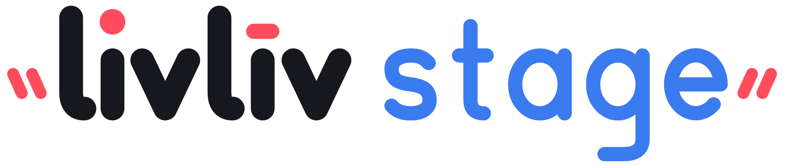
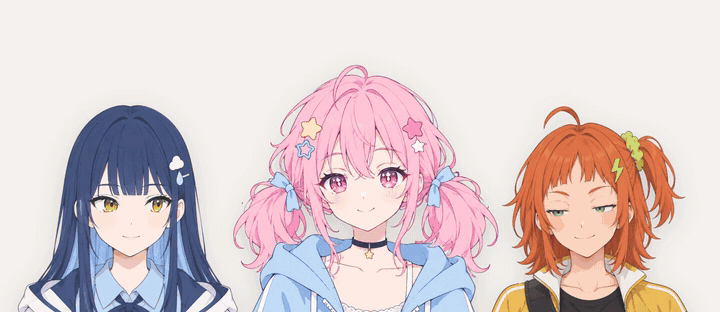
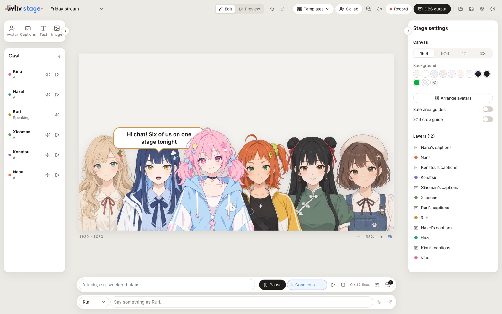

<p align="center">
  <picture>
    <source media="(prefers-color-scheme: dark)" srcset="media/livliv-stage-wordmark-white.svg">
    
  </picture>
</p>

<h3 align="center">Your AI-Native Studio for Character Videos and Streams<br><sub>Many characters. One stage.</sub></h3>

<p align="center">
  Put many characters on one stage. Play one with your webcam and let AI play the rest: they talk to each other and to
  your chat. Then record a video, or go live through OBS. In the browser or as a desktop app.<br>
  Comes with 27 featured characters in different styles, ready to use.
</p>

<p align="center"><b>English</b> · <a href="README.zh-CN.md">中文</a> · <a href="README.ja.md">日本語</a></p>

<p align="center"></p>

- Many characters on one stage: LivLiv (half-body and full-body), VRM and PNGTuber, each with its own driver and voice
- AI VTubers that talk to each other and to your Twitch chat, with LivLiv's AI (no key needed) or your own model
- Webcam face tracking and microphone lip sync; on desktop also phone tracking apps, VMC/OSC and global hotkeys
- Record the whole stage to MP4, or send it to OBS
- Built on [LivLiv Player](https://github.com/livliv-dev/player)

## Try it

- **Desktop app**: macOS and Windows from [Releases](https://github.com/livliv-dev/stage/releases/latest).
  On macOS, one line in Terminal installs it with no first-open prompt: `curl -fsSL https://livliv.ai/stage/install.sh | bash`
- **Online**: [livliv.ai/stage](https://livliv.ai/stage)
- **From source**: see [Develop](#develop)

<p align="center"></p>

## Characters

The featured characters have [their own licence](stage/public/characters/LICENSE.md). **Import** brings your own: a
`.livliv` package from [livliv.ai](https://livliv.ai), a VRM, or a PNGTuber.

## Project LivLiv

We want the art of creating characters to belong to everyone.

We're open-sourcing our AI tools for character creation, the player and its playback protocol, and a stage
where your characters can meet an audience.

Come say hello on [Discord](https://discord.gg/ac5qF36T2H) and follow us on [X (Twitter)](https://x.com/livliv_ai).

## Develop

Node.js 22.18 or later.

```sh
git clone https://github.com/livliv-dev/stage
cd stage
npm --prefix stage ci && npm --prefix stage run dev            # the web app at http://127.0.0.1:5222
npm --prefix desktop ci && npm --prefix desktop run stage:dev  # the desktop app (stage:mac, stage:win build installers)
```

Tests: `npm --prefix stage run check && npm --prefix stage test`, `npm --prefix desktop test`, `npm --prefix collab test`.
The local control API is in [docs/stage-api.md](docs/stage-api.md), co-streaming in [collab/README.md](collab/README.md).
Model keys stay in the browser or the app and go straight to the provider. Contributions: [CONTRIBUTING.md](CONTRIBUTING.md).
Security reports: [SECURITY.md](SECURITY.md).

## License

The code is under the [GNU AGPL version 3](LICENSE). The featured characters have
[their own licence](stage/public/characters/LICENSE.md). You may keep the LivLiv name and logo in your own versions,
as long as they don't claim to be the official one: [TRADEMARKS.md](TRADEMARKS.md).
