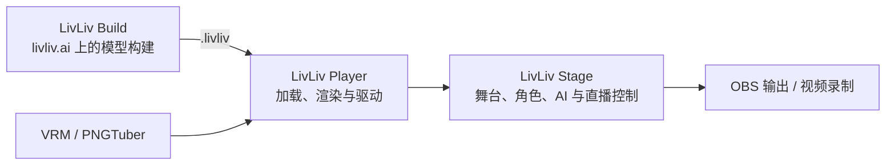

# LivLiv Stage

中文 · [English](#english)

LivLiv Stage 是角色直播工作台：用摄像头扮演角色，让 AI 回应观众，或把几个角色放在同一张舞台上，再输出到 OBS 或录成视频。支持 LivLiv、VRM 和 PNGTuber 角色。浏览器开发版和桌面版（Electron）共用同一份代码。

当前是开发预览版（0.2.2-preview.1），还没有发布安装包或 npm 包。推荐使用桌面版。



## 和 LivLiv Player、livliv.ai 的关系

- [LivLiv Player](https://github.com/livliv-dev/player) 是负责加载、渲染和驱动角色的开源库。Stage 只通过 `@livliv-dev/player` 的公开接口播放角色，不另写渲染器。依赖 npm 上的 `@livliv-dev/player` 0.4.0。
- [livliv.ai](https://livliv.ai) 把图片做成 LivLiv 角色。这个构建流程不在本仓库。Stage 不登录也能用；连接 livliv.ai 帐号后，可以使用你在那里的角色和角色自己的声音（消耗 livliv.ai 积分）。
- 随仓库提供 18 个精选角色，由 LivLiv 维护者更新。

## 运行

需要 Node.js 22.18 或更新版本。

浏览器开发版：

```sh
npm --prefix stage ci
npm --prefix stage run dev
```

打开终端显示的本机地址（`http://127.0.0.1:5222`）。示例角色和面捕资源都在仓库里，人工出镜不需要 AI 配置。开发页把 `/api`、`/models` 转发到本机 8000 端口（`LM_API_PORT` 可改），用于连接 LivLiv 接口；不连也能使用其他功能。

桌面版：

```sh
npm --prefix stage ci
npm --prefix desktop ci
npm --prefix desktop run stage:dev
```

`stage:dev` 先构建 `stage/`，再用 Electron 打开。LivLiv 接口默认连接 livliv.ai，开发时可用 `--api=http://127.0.0.1:8000` 改到本机。打包用 `npm --prefix desktop run stage:pack`（本机免安装包）、`stage:mac`（DMG/ZIP）或 `stage:win`（安装包），产物在 `desktop/release-stage/`。目前没有开发者签名和公证，macOS 第一次打开时需要右键「打开」，Windows 会显示 SmartScreen 提示。桌面外壳的更多说明见 [desktop/README.md](desktop/README.md)。

## 能做什么

- **面捕出镜**：选择摄像头，识别到面部后校准正面，再打开「输出到 OBS」。设备预览、失去面部和权限问题直接显示在设备面板。
- **AI 主播**：添加「AI 来演」的角色，在设置里配置模型和声音，打开「AI 直播」。可以连接 Twitch 弹幕，或用「试发一条弹幕」试运行。默认安静等待新弹幕；也可以设置冷场时定时说话。时长和生成次数分别设上限，到达任一项就停止。
- **多人同框**：每个角色可选「我来演」「AI 来演」「只展示」。对谈支持轮流、主持、插话、字幕和人设。远程朋友可以通过顶栏「联播」加入，信令服务见 [collab/README.md](collab/README.md)。
- **输入**：摄像头、麦克风口型、页面内鼠标跟随、手柄；桌面版还支持手机面捕（iFacialMocap）和 OSC/VMC，见 [追踪输入](docs/tracking-inputs.md)。「动作细调与预设」调整所有输入共用的转头、睁眼、张嘴等幅度。
- **舞台**：图片可以绑定在角色头部或身体上；命名镜头保存多套构图，切换时保留角色驱动和 AI 会话；统一调整麦克风、角色和朋友的音量；固定弹幕可以触发表情或动作。
- **输出与录制**：「输出到 OBS」打开独立的画面窗口，OBS 用窗口采集，背景可选透明或绿幕；不支持 OBS 浏览器源。录制把舞台重绘成 30 fps 的 MP4，保留字幕和角色声音，每段最长 10 分钟。
- **项目文件**：项目自动保存在本机，可以导出包含全部镜头、角色、图片和背景的 `.livstage` 文件，见 [项目文件](docs/project-format.md)。
- **桌面版**：全局热键（默认 `Ctrl+Alt+1…5` 表情、`0` 恢复、`Q/W` 点头与摇头、`Space` 校准、`M` 静音），以及给 Stream Deck 等工具用的 [本机控制 API](docs/stage-api.md)，两者默认关闭。

| 格式 | 角色表现 | 导入 |
| --- | --- | --- |
| LivLiv | 模型提供的头部、身体、表情、口型与物理效果 | `.livliv`、ZIP、模型文件夹 |
| VRM | 头部与身体动作、眨眼、模型提供的表情与口型 | `.vrm`（0.x / 1.0） |
| PNGTuber | 闭嘴、张嘴、闭眼图片切换和整体摆动 | 两张必选立绘，另可加两张闭眼立绘 |

没有手部追踪，也不能播放 Live2D/Cubism 模型。更多取舍见 [功能范围与平台差异](docs/stage-capabilities-and-web.md)。

## 还没有测试的

- Windows：没有在 Windows 上实际运行过。
- 真实手机：手机面捕只用模拟的数据测试过，实体手柄同样没有测试。
- OBS 的音画同步。
- 公网联播：联播只在本机或自托管的信令服务上测试过，没有公开的中继服务。

## AI 和你的 Key

AI 使用你自己的模型和语音服务的 Key，比如阿里云百炼、OpenAI、DeepSeek，或任何 OpenAI 兼容的接口，也可以用本机的 Ollama（推荐设置见 [首次使用与声音](docs/first-run-and-voice.md)）。Key 只保存在这个浏览器或桌面应用里，请求从你的电脑直接发给服务商（桌面版经应用自己转发），不经过 LivLiv，导出的项目文件里也没有 Key。费用由服务商计算；已经发出的请求可能已经产生费用。弹幕作为用户内容传给模型，和系统指令分开。

## 工程结构

- `stage/`：React/Vite 应用。`src/actors.ts` 管理 Player、设备与声音；`src/bodies/` 选择 Player 的 LivLiv、VRM 或 PNG 实现；`src/conversation.ts` 管对谈与 AI 直播的顺序、暂停、时长和次数；`src/tape.ts`、`src/render.ts` 录制并重绘视频。
- `desktop/`：Electron 外壳，提供全局热键、输出窗口、本机控制 API、UDP 输入和请求转发。
- `collab/`：联播用的独立信令服务。
- `docs/`：功能说明和接口文档。
- `stage/public/`：精选角色、示例声音和本地面捕资源。

## 测试

```sh
npm --prefix stage run check
npm --prefix stage test
npm --prefix desktop test
npm --prefix collab test
```

浏览器测试（`npm --prefix stage run test:browser` 等）需要 Playwright Chromium：`cd stage && npx playwright-core install chromium-headless-shell`。它们使用本机模拟的模型、声音、语音识别和摄像头，不调用付费服务。`npm --prefix desktop run test:stage` 会启动 Electron，目前只在 macOS 上运行。

## 许可

- 代码采用 [GNU AGPL 第 3 版](LICENSE)（仅第 3 版），另有 [附加条款](LICENSE-ADDITIONAL-TERMS.md)：
  - 你用 Stage 做出来的视频、录像和项目文件归你，不受这个许可约束。
  - 分发或在网上提供修改版时，要保留设置「关于」里的 LivLiv 署名，并换一个名字。
- 修改后分发或作为网络服务提供，要按 AGPL 公开对应的源代码。
- `stage/public/characters/` 里的精选角色不在 AGPL 范围内，适用它们自己的 [许可](stage/public/characters/LICENSE.md)（非商业使用，需要署名）。
- LivLiv 的名字和标志不随代码授权，见 [TRADEMARKS.md](TRADEMARKS.md)。分发修改版时请换一个名字和图标。

如果你分发自己的版本，请在「设置 → 关于」里保留 LivLiv 的署名和链接。这是请求，不是许可条件。

欢迎提交问题和 PR，见 [CONTRIBUTING.md](CONTRIBUTING.md)。安全问题请按 [SECURITY.md](SECURITY.md) 私下报告。

---

## English

LivLiv Stage is a workspace for streaming as a character: play a character with your webcam, let AI characters answer your chat, or put several characters on one stage, then send it to OBS or record a video. It plays LivLiv, VRM and PNGTuber characters. The browser development build and the desktop app (Electron) share the same code.

This is a development preview (0.2.2-preview.1). There are no released installers or npm packages yet. The desktop app is the recommended way to use it.

**Player and livliv.ai.** [LivLiv Player](https://github.com/livliv-dev/player) is the open-source library that loads, draws and drives the characters; Stage uses only its public API, from `@livliv-dev/player` 0.4.0 on npm. [livliv.ai](https://livliv.ai) turns pictures into LivLiv characters; that pipeline is not part of this repository. Stage works without an account; signed in to livliv.ai, you can use your characters there and their own voices (paid with livliv.ai points). The 18 featured characters in this repository are updated by the LivLiv maintainers.

**Run it.** You need Node.js 22.18 or later.

```sh
# browser development build, at http://127.0.0.1:5222
npm --prefix stage ci
npm --prefix stage run dev

# desktop app
npm --prefix desktop ci
npm --prefix desktop run stage:dev    # builds stage/ first
npm --prefix desktop run stage:pack   # unpacked app in desktop/release-stage/; stage:mac and stage:win make installers
```

The builds are not signed or notarised. The development page forwards `/api` and `/models` to port 8000 on this computer (`LM_API_PORT`) for a LivLiv API; everything else works without it. The desktop app talks to livliv.ai unless you pass `--api=<origin>`.

**What works.** Webcam face tracking with calibration; AI characters with your own model and voice keys, Twitch chat, time and generation limits; several characters on one stage, each played by you, by AI or just shown; co-streaming with friends through a self-hosted signalling server ([collab/README.md](collab/README.md)); gamepad input, and on desktop iFacialMocap and OSC/VMC ([docs/tracking-inputs.md](docs/tracking-inputs.md)); pictures attached to a character's head or body; named shots; one place for microphone, character and friend volumes; chat commands that trigger expressions; a separate output window for OBS window capture (transparent or green; no OBS browser source); 30 fps MP4 recording; `.livstage` project files with all assets; global hotkeys and a local control API on desktop ([docs/stage-api.md](docs/stage-api.md)). There is no hand tracking and no Live2D/Cubism playback. The docs in `docs/` are in Chinese.

**Not tested yet.** Windows (not run on Windows yet), real phones and gamepads (only simulated input), OBS audio and video sync, and a public relay for co-streaming: co-streaming has only been run locally or self-hosted.

**Your AI keys** stay in this browser or app. Requests go from your computer straight to the provider (through the app itself on desktop), never through LivLiv, and project files leave them out. The provider bills you; a request that was already sent may already cost money.

**Checks:** `npm --prefix stage run check`, `npm --prefix stage test`, `npm --prefix desktop test`, `npm --prefix collab test`.

**Licence.** The code is under the [GNU AGPL version 3](LICENSE) (version 3 only) with [additional terms](LICENSE-ADDITIONAL-TERMS.md): videos, recordings and project files you make with Stage are yours and not covered by it; a modified version you distribute or offer over a network keeps the LivLiv credit in Settings → About and uses its own name, and its source must be offered as the AGPL requires. The featured characters in `stage/public/characters/` have [their own licence](stage/public/characters/LICENSE.md) (non-commercial, with credit). The LivLiv names and logos are not licensed with the code: see [TRADEMARKS.md](TRADEMARKS.md); a modified version you distribute needs its own name and icon.


Issues and pull requests are welcome: [CONTRIBUTING.md](CONTRIBUTING.md). Report security problems privately: [SECURITY.md](SECURITY.md).
