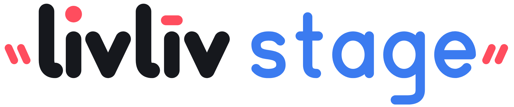
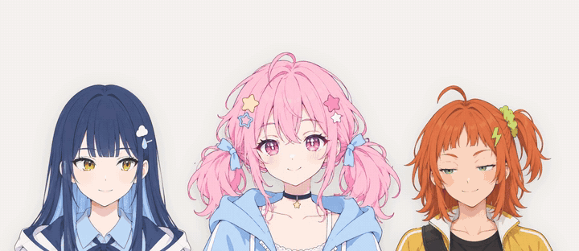

<p align="center">
  <picture>
    <source media="(prefers-color-scheme: dark)" srcset="media/livliv-stage-wordmark-white.svg">
    
  </picture>
</p>

<h3 align="center">Your AI VTuber Studio</h3>

<p align="center">
  Give a character a personality, and in minutes it's chatting with you or streaming live. Or play it yourself.
</p>

<p align="center"><b>English</b> · <a href="README.zh-CN.md">中文</a> · <a href="README.ja.md">日本語</a></p>

<p align="center"></p>

## New in 1.0 Preview

Stage is reorganised around what you came to do. [Download the 1.0 Preview](https://github.com/livliv-dev/stage/releases/tag/v1.0.0-preview) and tell us what feels wrong before 1.0.

- **Start with a goal**: **I perform** (with an AI partner if you like), **AI goes live**, **Chat with a character** or **Make a video**. Each opens a checklist of only what it needs, and every item has a **Test** button
- **One start button**, named after what it starts (**Go live**, **Start chat**, **Record**), with three choices beside it: **Who takes part**, **Who watches** and **Do you join?**
- **Private chats stay private**: while a live audience, a recording or the output window is on, characters leave private memory alone. The status line shows which one you're in, and the model, voice and engine
- **Free voices on your own computer** with [Voicebox](https://voicebox.sh) (desktop app): used when no other voice is set, and a chat that starts free stays free
- **Character cards**: import SillyTavern or AIRI cards (V2 and V3, JSON or PNG) as a character's persona
- **Settings → Connect** holds every key, with one key for everything where the provider allows it. The desktop app keeps keys encrypted by the system

## Also in Stage

- Up to 30 characters on one stage (15 in a browser): LivLiv half-body and full-body, VRM and PNGTuber, with 27 featured characters ready to use
- Characters talk to each other and to your Twitch chat, react with emotion, remember you and take realtime calls. In the desktop app each character keeps its own memory, powered by [Project AIRI](https://github.com/moeru-ai/airi)
- Desktop app: games (Minecraft through [Airicraft](https://github.com/proj-airi/airicraft), Factorio through [Autorio](https://github.com/moeru-ai/airi-factorio), or any game window the character watches), the Neuro SDK, phone face tracking and VMC/OSC
- Webcam face tracking, OBS output and video recording. Built on [LivLiv Player](https://github.com/livliv-dev/player)

The AI runs on your own model key (OpenAI, Qwen, DeepSeek and more), or your LivLiv.ai account. A realtime call
needs your own OpenAI or Alibaba Cloud Bailian key.

## Try it

- **Desktop app** for macOS and Windows: the [1.0 Preview](https://github.com/livliv-dev/stage/releases/tag/v1.0.0-preview) (pre-release), or the stable version from [Releases](https://github.com/livliv-dev/stage/releases/latest).
  If GitHub is slow, use the [backup download](https://downloads.livliv.ai/stage/index.html) (stable version).
  On macOS, one line in Terminal installs the stable version with no first-open prompt: `curl -fsSL https://livliv.ai/stage/install.sh | bash`
- **Online (Web, limited features)**: [livliv.ai/stage](https://livliv.ai/stage)
- **From source**: see [Develop](#develop)

<p align="center"></p>

## Characters

The featured characters have [their own licence](stage/public/characters/LICENSE.md). **Import** brings your own: a
`.livliv` package from [livliv.ai](https://livliv.ai), a VRM, or a PNGTuber.

## Project LivLiv

We want the art of creating characters to belong to everyone.

We're open-sourcing our AI tools for character creation, [the player and its playback protocol](https://github.com/livliv-dev/player),
and [a stage where your characters can meet an audience](https://github.com/livliv-dev/stage).

Come say hello on [Discord](https://discord.gg/ac5qF36T2H) and follow us on [X (Twitter)](https://x.com/livliv_ai).

## Develop

Node.js 22.18 or later.

```sh
git clone https://github.com/livliv-dev/stage
cd stage
npm --prefix stage ci && npm --prefix stage run dev            # the web app at http://127.0.0.1:5222
npm --prefix desktop ci && npm --prefix desktop run stage:dev  # the desktop app (stage:mac, stage:win build installers)
```

Tests: `npm --prefix stage run check && npm --prefix stage test`, `npm --prefix desktop test`, `npm --prefix collab test`;
the browser checks are the `test:*` scripts in [stage/package.json](stage/package.json), and GitHub Actions runs all of these on every pull request.
AI chat and memory: [docs/ai-conversations.md](docs/ai-conversations.md), real-time voice:
[docs/realtime-voice.md](docs/realtime-voice.md), built-in AIRI ([docs/airi.md](docs/airi.md)), the Neuro SDK bridge: [neuro/README.md](neuro/README.md), the local control API:
[docs/stage-api.md](docs/stage-api.md), friend collab: [collab/README.md](collab/README.md).
Model keys stay in the browser or the app and go straight to the provider; the desktop app keeps them, and its
LivLiv sign-in, encrypted by the system (Keychain, DPAPI or a Linux keyring) and removes them from the page's storage
once they are written there. Contributions: [CONTRIBUTING.md](CONTRIBUTING.md).
Security reports: [SECURITY.md](SECURITY.md).

## License

Stage's code is under the [Apache License 2.0](LICENSE). The bundled [AIRI core](vendor/airi-core/LICENSE) and its
[dependencies](vendor/airi-core/DEPENDENCY-NOTICES.txt) carry their own licenses. The featured characters have
[their own licence](stage/public/characters/LICENSE.md). You may keep the LivLiv name and logo in your own versions,
as long as they don't claim to be the official one: [TRADEMARKS.md](TRADEMARKS.md).
