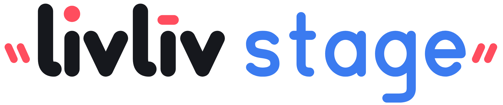
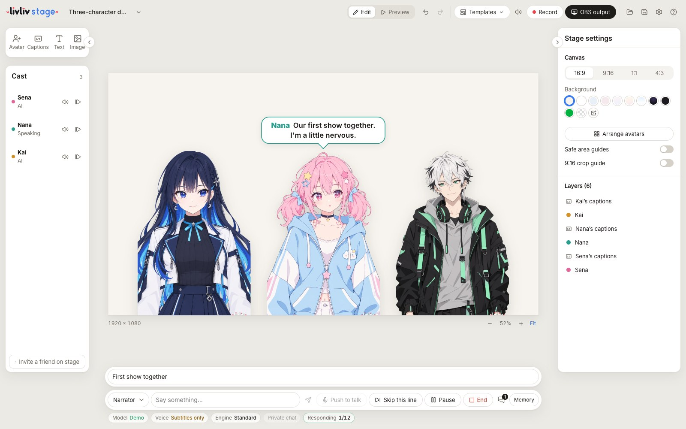

<p align="center">
  <picture>
    <source media="(prefers-color-scheme: dark)" srcset="media/livliv-stage-wordmark-white.svg">
    
  </picture>
</p>

<h3 align="center">你的 AI 虚拟主播工作室</h3>

<p align="center">
  给角色设定好性格，几分钟它就能和你聊天，或者直接开播。也可以自己来演。
</p>

<p align="center"><a href="README.md">English</a> · <b>中文</b> · <a href="README.ja.md">日本語</a></p>

<p align="center"></p>

- 一张舞台最多 30 个角色（浏览器里 15 个）：LivLiv 半身和全身、VRM、PNGTuber
- 长期记忆和实时语音对话
- 角色之间互相对话，也回应 Twitch 弹幕
- 说话时跟着情绪变的表情
- 内置 Neuro SDK 支持（桌面版）
- 基础功能都有：摄像头面捕（手机面捕 App 和 VMC/OSC 用桌面版）、OBS 输出、录视频
- 27 个精选角色，开箱即用。基于 [LivLiv Player](https://github.com/livliv-dev/player)

AI 可以用你自己的模型密钥（OpenAI、通义千问、DeepSeek 等），也可以使用 LivLiv.ai 帐号。
实时语音需要你自己的 OpenAI 或阿里云百炼密钥。

## 试一试

- **桌面版**：macOS 和 Windows，到 [Releases](https://github.com/livliv-dev/stage/releases/latest) 下载。
  GitHub 下载较慢时，可使用[备用下载](https://downloads.livliv.ai/stage/index.html)。
  macOS 也可以在终端里一行装好，第一次打开不会被拦：`curl -fsSL https://livliv.ai/stage/install.sh | bash`
- **在线（网页版，功能受限）**：[livliv.ai/stage](https://livliv.ai/stage)
- **从源码运行**：见[开发](#开发)

<p align="center"></p>

## 角色

精选角色有[单独的许可](stage/public/characters/LICENSE.md)。用「导入」放上你自己的角色：[livliv.ai](https://livliv.ai) 的模型包（`.livliv`）、
VRM 或 PNGTuber。

## Project LivLiv

我们希望，创造角色这件事能属于每一个人。

我们正在开源 AI 角色创作工具链、[播放器与播放协议](https://github.com/livliv-dev/player)，还有[一方舞台，让你创作的角色与大家见面](https://github.com/livliv-dev/stage)。

欢迎来 [Discord](https://discord.gg/ac5qF36T2H) 聊聊角色创作，也可以在 [X（Twitter）](https://x.com/livliv_ai) 上关注我们。

## 开发

需要 Node.js 22.18 或更新版本。

```sh
git clone https://github.com/livliv-dev/stage
cd stage
npm --prefix stage ci && npm --prefix stage run dev            # 网页版，http://127.0.0.1:5222
npm --prefix desktop ci && npm --prefix desktop run stage:dev  # 桌面版（stage:mac、stage:win 打安装包）
```

测试：`npm --prefix stage run check && npm --prefix stage test`、`npm --prefix desktop test`、`npm --prefix collab test`。
AI 聊天和记忆见 [docs/ai-conversations.md](docs/ai-conversations.md)，实时语音见 [docs/realtime-voice.md](docs/realtime-voice.md)，
Neuro SDK 桥接见 [neuro/README.md](neuro/README.md)，本机控制接口见 [docs/stage-api.md](docs/stage-api.md)，联播见 [collab/README.md](collab/README.md)。
模型密钥只存在浏览器或应用里，请求直接发给服务商。欢迎贡献：[CONTRIBUTING.md](CONTRIBUTING.md)。
安全问题：[SECURITY.md](SECURITY.md)。

## 许可

代码采用 [Apache License 2.0](LICENSE)。精选角色有[自己的许可](stage/public/characters/LICENSE.md)。
你的版本可以继续用 LivLiv 的名字和标志，只要不自称官方版本，见 [TRADEMARKS.md](TRADEMARKS.md)。
