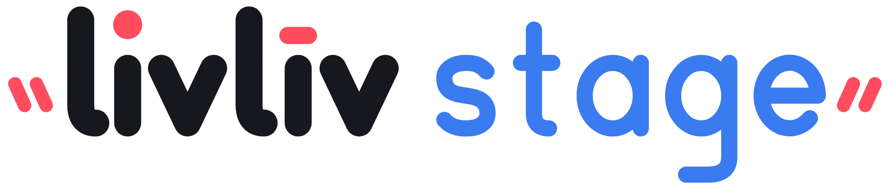
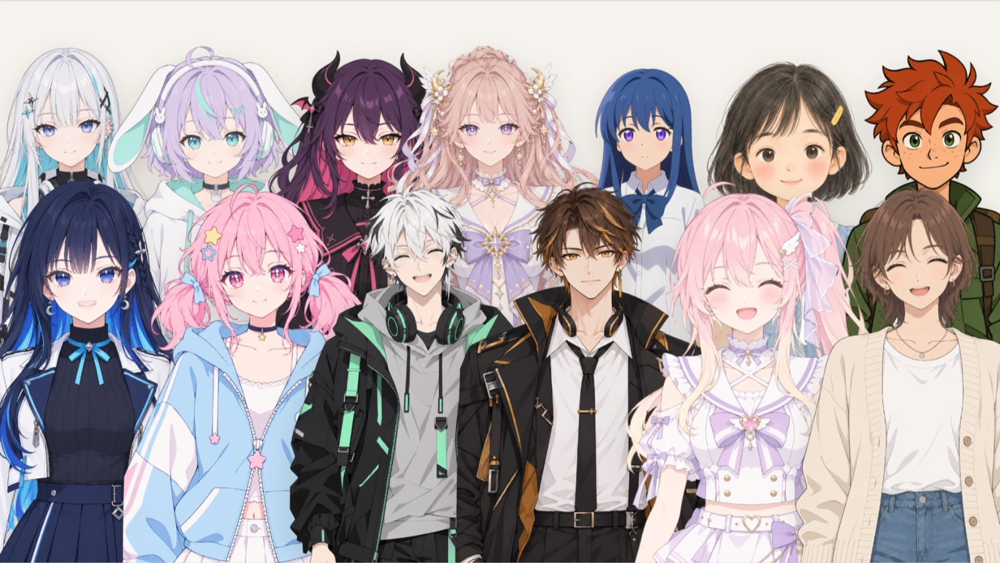

<p align="center">
  <picture>
    <source media="(prefers-color-scheme: dark)" srcset="media/livliv-stage-wordmark-white.svg">
    
  </picture>
</p>

<h3 align="center">AI 原生的角色视频和直播工作室<br><sub>很多角色，同一个舞台。</sub></h3>

<p align="center">
  把很多角色放上同一个舞台。用摄像头扮演其中一个，其余的交给 AI，让它们彼此聊天、回应弹幕，再录成视频，或者通过 OBS 开播。
  浏览器和桌面都能用。
</p>

<p align="center"><a href="README.md">English</a> · <b>中文</b> · <a href="README.ja.md">日本語</a></p>

<p align="center"></p>

- 很多角色同台：LivLiv（半身和全身）、VRM 和 PNGTuber，每个角色有自己的驱动方式和声音
- AI 主播彼此接话、回应 Twitch 弹幕，用 LivLiv 的 AI（无需密钥）或你自己的模型
- 摄像头面捕、麦克风口型；桌面版还支持手机面捕 App、VMC/OSC 和全局热键
- 整张舞台录成 MP4，或者送进 OBS
- 自带 27 个精选角色，开箱即用。基于 [LivLiv Player](https://github.com/livliv-dev/player)

## 试一试

- **在线**：[livliv.ai/stage](https://livliv.ai/stage)
- **桌面版**：macOS 和 Windows，到 [Releases](https://github.com/livliv-dev/stage/releases/latest) 下载。
  macOS 也可以在终端里一行装好，第一次打开不会被拦：`curl -fsSL https://livliv.ai/stage/install.sh | bash`
- **从源码运行**：见[开发](#开发)

<p align="center"></p>

## 角色

[`stage/public/characters/`](stage/public/characters/) 里有 27 个精选角色，其中 4 个是全身角色。个人非商业的视频和直播可以免费使用，
需要署名，见[角色许可](stage/public/characters/LICENSE.md)。

用「导入」放上你自己的角色：[livliv.ai](https://livliv.ai) 下载的模型包（`.livliv`）、VRM，或者 PNGTuber（两张或四张图）。

## Project LivLiv

我们希望，创造角色这件事能属于每一个人。

我们正在开源 AI 角色创作工具链、播放器与播放协议，还有一方舞台，让你创作的角色与大家见面。

欢迎来 [Discord](https://discord.gg/ac5qF36T2H) 聊聊角色创作，也可以在 [X（Twitter）](https://x.com/livliv_ai) 上关注我们。

## 开发

需要 Node.js 22.18 或更新版本。

```sh
git clone https://github.com/livliv-dev/stage
cd stage
npm --prefix stage ci && npm --prefix stage run dev            # 网页版，http://127.0.0.1:5222
npm --prefix desktop ci && npm --prefix desktop run stage:dev  # 桌面版（stage:mac、stage:win 打安装包）
```

测试：`npm --prefix stage run check && npm --prefix stage test`、`npm --prefix desktop test`、`npm --prefix collab test`。
本机控制接口见 [docs/stage-api.md](docs/stage-api.md)，联播见 [collab/README.md](collab/README.md)。
模型密钥只存在浏览器或应用里，请求直接发给服务商。欢迎贡献：[CONTRIBUTING.md](CONTRIBUTING.md)。
安全问题：[SECURITY.md](SECURITY.md)。

## 许可

代码采用 [GNU AGPL 第 3 版](LICENSE)。精选角色有[自己的许可](stage/public/characters/LICENSE.md)。
你的版本可以继续用 LivLiv 的名字和标志，只要不自称官方版本，见 [TRADEMARKS.md](TRADEMARKS.md)。
